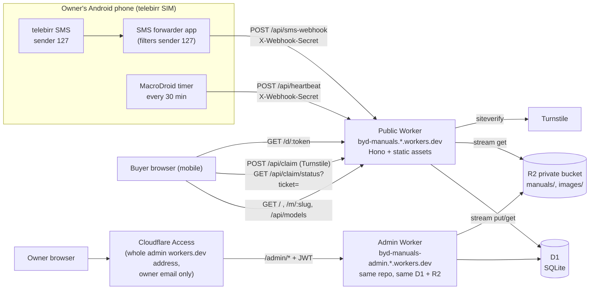
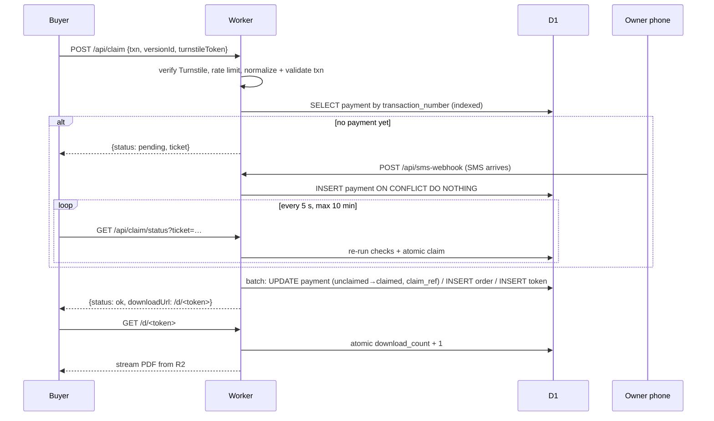
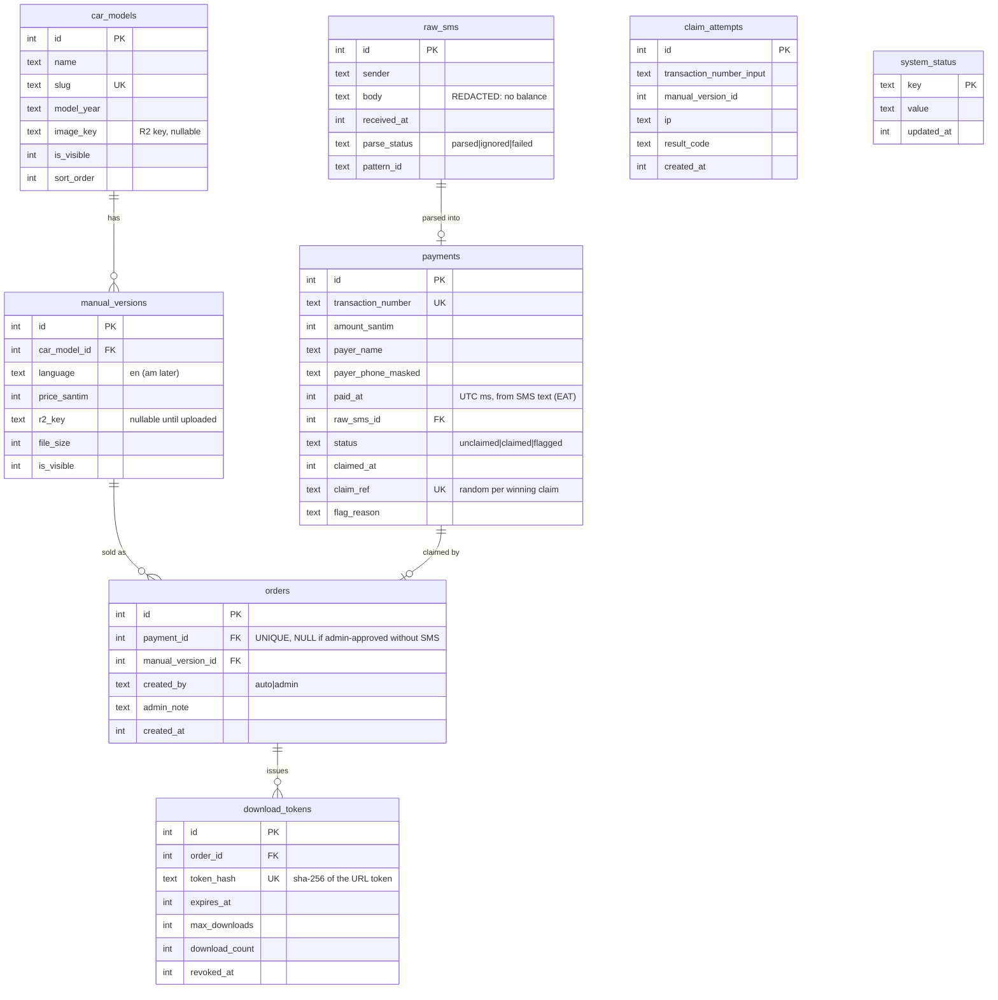
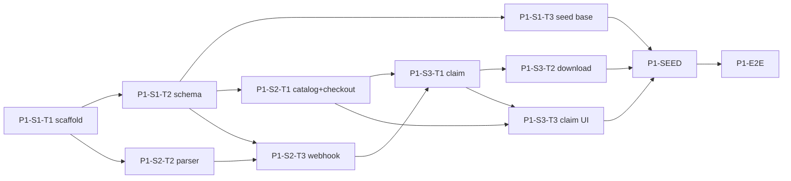
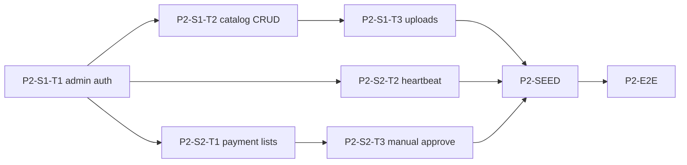
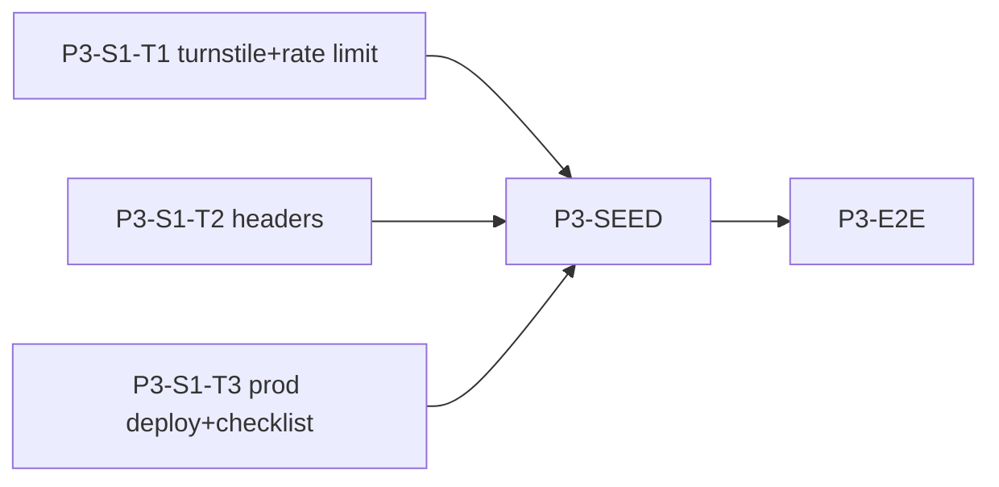

# BYD Manual Store (MVP) — Architecture

Source PRD: `docs/prd.md` (v5, 2026-10-28). This document is for the owner deciding direction. Claude Code sessions read `CLAUDE.md` and one task file, not this whole document.

---

## 1. Overview

A small website that sells English translations of China-market BYD owner's manuals to buyers in Ethiopia. Buyers pay 500 ETB by **telebirr-to-telebirr transfer** to the owner's personal number. The owner's Android phone forwards the telebirr SMS to the site. The buyer types the transaction number from their own confirmation, the site matches it against the forwarded SMS, and it releases a time-limited download link.

**Who it's for**
- **Buyer**: a BYD owner or mechanic, on a phone, on mobile data, with telebirr.
- **Owner/admin**: one person who uploads manuals, watches payments and handles exceptions.

**Core goal**: answer "will owners pay?" with at least 20 paid orders in 30 days. At least 90% of orders should be verified automatically, a PDF should be available within 2 minutes (p90), and **no PDF may ever be released without a payment**.

**The flow that must work**: pay → enter transaction number → download. Everything else supports this flow.

## 2. Chosen stack & rationale

| Layer | Choice | Why for this project |
|---|---|---|
| Runtime | Cloudflare Workers (free plan), one Worker | Required by the PRD; $0 hosting |
| Web framework | **Hono 4** with `hono/jsx` server-rendered HTML | Tiny bundle and very little CPU per request, which fits the ~10 ms free-plan CPU limit. Plain HTML loads fast on mobile data. |
| Static files | Workers Static Assets (`public/`) | CSS, client JS and placeholder images are served without using Worker CPU |
| Client JS | Vanilla ES modules, no build step | Only two scripts are needed (claim polling, admin upload) |
| Database | Cloudflare D1, **raw SQL** + `wrangler d1 migrations` | Full control of indexes and the atomic claim batch; no ORM weight |
| File storage | Cloudflare R2, private bucket | PDFs never get a public URL; no egress fees |
| Admin auth | Cloudflare Access + JWT check in the Worker (`jose`) | No password code of our own; the JWT check protects against a misconfigured Access app |
| Bot protection | Turnstile | Free; Cloudflare's test keys work in local dev and CI |
| Language | TypeScript (strict) | |
| Lint/format | Biome | One fast tool for both |
| Unit/integration tests | Vitest + `@cloudflare/vitest-pool-workers` | Tests run inside the real Workers runtime with local D1 and R2 |
| E2E tests | Playwright (mobile Chrome profile) against `wrangler dev` | Matches the real buyer device |
| Package manager | pnpm, Node 22 | |
| CI/CD | GitHub Actions + `cloudflare/wrangler-action` + `anthropics/claude-code-action` | |

## 3. System architecture



**Claim sequence (the critical path)**



**Module layout**

```
src/
  index.ts                 PUBLIC Worker: Hono app, global middleware, route mounting (no admin)
  admin-worker.ts          ADMIN Worker entry: mounts routes/admin.tsx at /admin
  admin-env.ts             AdminEnv type (public Env + Access vars)
  env.ts                   AppEnv type (Bindings from worker-configuration.d.ts)
  routes/
    public.tsx             GET /, GET /m/:slug, GET /media/images/*
    api.ts                 GET /api/models
    claim.ts               POST /api/claim, GET /api/claim/status
    webhook.ts             POST /api/sms-webhook
    heartbeat.ts           POST /api/heartbeat
    download.ts            GET /d/:token
    admin.tsx              /admin shell + dashboard; mounts admin/* (admin Worker only)
    admin/{catalog,uploads,payments,orders}.tsx
  middleware/{admin-auth,security}.ts
  lib/
    sms/{parser,patterns,redact}.ts
    db/{types,catalog,payments,admin-queries}.ts
    claim.ts               claim service + createOrderWithToken
    token.ts               download token generate/hash
    ticket.ts              HMAC poll tickets
    turnstile.ts, rate-limit.ts, secrets.ts, money.ts, time.ts
  views/                   hono/jsx components (layout, catalog, checkout, admin/*)
public/                    css/, js/, img/, robots.txt
migrations/                0001_init.sql, 0002_system_status.sql
scripts/                   seed.ts, fake-sms.sh, run-task.sh, parallel-group.sh
test/                      vitest (runs in workerd)
e2e/                       playwright specs
```

## 4. Data model

All money is stored as **integer santim** (1 ETB = 100 santim) so no floating-point rounding can happen. All timestamps are **integer Unix milliseconds, UTC**.



**Indexes** (D1 bills rows *scanned*, so every hot path must hit one):
- `payments(transaction_number)` UNIQUE: claim, poll, webhook
- `payments(claim_ref)` UNIQUE: claim batch
- `payments(status, paid_at)`: admin lists
- `download_tokens(token_hash)` UNIQUE: download
- `orders(payment_id)` UNIQUE
- `claim_attempts(ip, created_at)`: rate limit
- `raw_sms(parse_status, received_at)`: admin SMS list, last-SMS time
- `manual_versions(car_model_id, language)` UNIQUE

**Deliberate differences from the PRD's table** (same intent, safer implementation):

| PRD | Here | Why |
|---|---|---|
| `amount_etb`, `price_etb` | `amount_santim`, `price_santim` integers | No float rounding on `1,500.00` |
| `download_tokens.token` | `token_hash` (SHA-256) | A leaked database does not leak working download links. The URL still carries the 32-byte random token. |
| `orders.payment_id` NOT NULL | nullable (still UNIQUE) | FR-26 "SMS was lost" approvals have no payment row |
| `raw_sms.body` as received | stored **after redaction** (balance and long digit runs removed) | FR-10 |
| — | `payments.claim_ref`, `payments.flag_reason`, `download_tokens.revoked_at`, `system_status` | Atomic claim, admin context, link regeneration, heartbeat |

## 5. API design

| Endpoint | Method | Auth | Request | Responses |
|---|---|---|---|---|
| `/` | GET | public | — | Catalog HTML |
| `/m/:slug` | GET | public | — | Checkout HTML (404 if hidden) |
| `/media/images/*` | GET | public | — | Car image streamed from R2 (only the `images/` prefix) |
| `/api/models` | GET | public | — | `[{slug, name, modelYear, imageUrl, versions:[{id, language, priceEtb, available}]}]` |
| `/api/claim` | POST | Turnstile + rate limit | `{transactionNumber, versionId, turnstileToken}` | `{status:"ok", downloadUrl}` · `{status:"pending", ticket, retryAfterMs:5000}` · `{status:"error", code, message}` |
| `/api/claim/status` | GET | signed ticket | `?ticket=` | Same three shapes as above. After the ticket expires: `{status:"error", code:"NOT_FOUND"}` |
| `/api/sms-webhook` | POST | `X-Webhook-Secret` | `{from, body, receivedAt}` | Always `200 {result:"stored"\|"duplicate"\|"ignored"\|"failed"\|"discarded"}` when the secret is valid; `401` otherwise |
| `/api/heartbeat` | POST | `X-Webhook-Secret` | `{}` (optional `{battery}`) | `200 {ok:true}` |
| `/d/:token` | GET | token | `Range` optional | `200`/`206` PDF stream · `410` HTML page if invalid, expired, revoked or used up |
| `/admin/*` (**admin Worker** only; the public Worker returns 404) | GET/POST/PUT | Access JWT + owner email + same-origin check on writes | forms, raw-body PUT for uploads | HTML |
| `/healthz` | GET | public | — | `{ok:true, env}` |

**Claim error codes**: `INVALID_FORMAT`, `INVALID_VERSION`, `ALREADY_USED`, `AMOUNT_TOO_LOW`, `EXPIRED`, `RATE_LIMITED`, `BOT_CHECK_FAILED`, `NOT_FOUND` (only after the 10-minute wait). PRD's `NOT_FOUND_YET` is represented by `status:"pending"`.

**Why a poll ticket (a change from the PRD)**: a Turnstile token can be used only once, so 120 polls cannot each carry one. The first `POST /api/claim` passes Turnstile and the rate limit. If no payment exists yet, it returns a ticket: `base64url(txn|versionId|expiresAt) + "." + HMAC-SHA256(TICKET_SECRET)`, valid for 10 minutes. Polls then use `GET /api/claim/status`, which needs a valid ticket and nothing else. Polls cost no D1 writes and stop when the ticket expires.

**Claim algorithm** (in `src/lib/claim.ts`):
1. Normalize (trim, uppercase, strip spaces) → check `^[A-Z0-9]{10}$` or return `INVALID_FORMAT`.
2. Load the visible version with a PDF, or return `INVALID_VERSION`.
3. `SELECT` payment by `transaction_number`. If there is none → `pending`.
4. `status='claimed'` → `ALREADY_USED`. `status='flagged'` → `AMOUNT_TOO_LOW`.
5. `amount_santim < price_santim` → flag the payment (`UPDATE … SET status='flagged' WHERE id=? AND status='unclaimed'`) → `AMOUNT_TOO_LOW`.
6. `paid_at < now − CLAIM_WINDOW_DAYS` → `EXPIRED`.
7. One `db.batch()` (D1 runs a batch as a single transaction):
   - `UPDATE payments SET status='claimed', claimed_at=?, claim_ref=?R WHERE transaction_number=? AND status='unclaimed' AND amount_santim>=? AND paid_at>=?`
   - `INSERT INTO orders (payment_id, manual_version_id, created_by, created_at) SELECT id, ?, 'auto', ? FROM payments WHERE claim_ref=?R`
   - `INSERT INTO download_tokens (order_id, token_hash, expires_at, max_downloads, download_count, created_at) SELECT o.id, ?, ?, ?, 0, ? FROM orders o JOIN payments p ON p.id=o.payment_id WHERE p.claim_ref=?R`

   `?R` is a fresh random value for each request. Success requires `changes === 1` on the first statement. A racing request either matches 0 rows or writes nothing, because its `?R` never appears in the table. This is FR-14's guarantee extended to cover order and token creation.
8. On `changes === 0`, re-read the payment and return `ALREADY_USED`.
9. Every POST and every final poll result writes one `claim_attempts` row.

**Download algorithm** (`/d/:token`): hash the token → look up by `token_hash` → reject if expired, revoked or used up → if the request has no `Range` header, or the range starts at 0, run `UPDATE download_tokens SET download_count=download_count+1 WHERE id=? AND download_count<max_downloads AND expires_at>? AND revoked_at IS NULL` and continue only if `changes===1` → `MANUALS.get(r2_key, {range})` → stream `object.body` with `Content-Disposition: attachment`. Resumed downloads (range starting after 0) do not use up one of the 3 downloads.

## 6. Auth & security

- **Webhook and heartbeat**: `X-Webhook-Secret` compared with `crypto.subtle.timingSafeEqual`. The secret is a Worker secret, different in each environment. To rotate it, update the secret in Cloudflare and in the forwarder app.
- **Sender filtering**: done twice. The phone forwards only sender `127`, and the server keeps only `from === "127"`. Anything else is discarded and not stored (FR-7).
- **Admin**: admin runs as a **separate Worker** (`wrangler.admin.jsonc`, entry `src/admin-worker.ts`) on its own `workers.dev` address, because Access can't be limited to one path on a `workers.dev` address and there is no custom domain until after the project. Cloudflare Access is switched on for that whole address (one-click Access for `workers.dev`) and allows only the owner's email. The public Worker contains no admin code. The admin Worker also verifies the `Cf-Access-Jwt-Assertion` JWT (issuer = team domain, audience = `ACCESS_AUD`, `email === ADMIN_EMAIL`) on every `/admin` request. Non-GET admin requests must have `Origin` equal to the site origin (CSRF). Admin responses are `no-store` and `noindex`.
  - Local dev only: admin auth is bypassed when `ENVIRONMENT=development` **and** `ADMIN_DEV_BYPASS=1` **and** the host is `localhost`/`127.0.0.1`. All three conditions are required, so the bypass cannot activate on staging or production.
- **Claim**: Turnstile on POST, 10 attempts per IP per 10 minutes (counted from `claim_attempts`), no fuzzy matching.
- **Downloads**: 32-byte random token (base64url), only its SHA-256 is stored, 24 h / 3 downloads, revocable. The R2 bucket has no public access and no r2.dev URL.
- **Personal data**: payer name and masked phone appear only in admin pages. Logs use event names and IDs, never names, phone numbers, SMS bodies or tokens.
- **Secrets**: `wrangler secret put` per environment; `.dev.vars` (git-ignored) for local. Nothing secret goes in `wrangler.jsonc`.
- **Headers** (Phase 3): CSP (self + Turnstile), `X-Content-Type-Options`, `Referrer-Policy: no-referrer` on `/d/*`, `X-Robots-Tag: noindex` on all non-production environments, on `/d` in production, and always on the admin Worker.

## 7. Third-party integrations

| Integration | How | Notes |
|---|---|---|
| telebirr | None directly. We read SMS from sender `127` on the owner's phone. | Format confirmed (PRD Pattern 1). Personal-account limits: PRD risk 4. |
| SMS forwarder (Android) | Any app that can POST JSON to HTTPS with a custom header and filter by sender. First candidate: the open-source "SMS to URL forwarder" (`bogkonstantin/android_income_sms_gateway_webhook`), which supports a JSON template and custom headers. | Template: `{"from":"%from%","body":"%text%","receivedAt":"%receivedStamp%"}`. Test it for 48 h (PRD Q6). |
| Phone heartbeat | MacroDroid (free) macro: every 30 min, HTTP POST `/api/heartbeat` with the secret header | Needed because "no SMS" also happens when there are no sales, so SMS alone can't tell us the phone is down |
| Cloudflare Access | Switched on for the admin Worker's whole `workers.dev` address; policy: owner email, one-time PIN login | Works without a custom domain; the public Worker's address keeps Access off |
| Turnstile | Managed widget on the checkout page; `siteverify` on the server | Test keys in dev/CI |

## 8. Infra & deployment

**Environments**

| Env | Worker | D1 / R2 | URL | Purpose |
|---|---|---|---|---|
| local | `wrangler dev` (public :8787) + `wrangler dev -c wrangler.admin.jsonc` (admin :8788) | miniflare (`.wrangler/state`, shared by both) | `localhost:8787` / `localhost:8788` | Development, unit tests, E2E |
| staging | `byd-manuals-staging` + `byd-manuals-admin-staging` | `byd-manuals-staging` / `byd-manuals-staging` (shared) | `byd-manuals-staging.<acct>.workers.dev` / `byd-manuals-admin-staging.<acct>.workers.dev` | Phase preview; fake data only |
| production | `byd-manuals` + `byd-manuals-admin` | `byd-manuals` / `byd-manuals` (shared) | `byd-manuals.<acct>.workers.dev` (custom domain optional later) / `byd-manuals-admin.<acct>.workers.dev` | Live sales |

D1, R2 and vars are **not inherited** between wrangler environments, so each `env.*` block repeats them on purpose. `wrangler.admin.jsonc` must use the **same** D1 id and R2 bucket as `wrangler.jsonc` for each env. `preview_urls: false` on both Workers.

**Why a staging Worker rather than Cloudflare's per-branch preview URLs**: preview versions of a Worker use the *same* D1 database and R2 bucket as production. A preview would therefore read and write live payments. Only one phase is open at a time, so one staging Worker deployed from the open `phase-N` branch gives a stable live URL for every phase.

**Domain timing**: no custom domain during the project; everything runs on `workers.dev`. A domain can be attached to the public Worker later (launch checklist, optional step) with no code change. The admin Worker can stay on `workers.dev`.

**Branching**
- `main` is always the last approved phase. Production deploys only from tags on `main`.
- Each phase gets a branch `phase-<N>` from `main`. Every push deploys staging and runs E2E.
- Task branches `task/<TASK-ID>` branch from the phase branch and merge back into it with squash merges.
- When a phase is approved: merge `phase-<N>` → `main`, tag `v0.<N>-phase<N>`.

**Seed data**: `pnpm seed:local` / `pnpm seed:staging` runs `scripts/seed.ts`, which resets the tables and loads demo models, placeholder PDFs, and demo payments with known transaction numbers. It **refuses to run against production**. `scripts/fake-sms.sh` posts a realistic telebirr SMS to any non-production environment, so a demo can show "payment arrives while the buyer waits".

**CI (GitHub Actions)**
- `ci.yml`: on PRs into `phase-*` and `main`: Biome lint, `tsc --noEmit`, Vitest.
- `claude-review.yml`: on PRs into `phase-*`: automated Claude review (Sonnet) that must write `PASS` for the check to go green.
- `e2e.yml`: on pushes to `phase-*`: Playwright against `wrangler dev` with a freshly migrated and seeded local D1.
- `deploy-staging.yml`: on pushes to `phase-*`: remote migrations + deploy the public Worker + deploy the admin Worker (once `wrangler.admin.jsonc` exists) + reseed staging.
- `deploy-production.yml` (added in P3-S1-T3): on tags `v*`, with a manual approval environment.

Repo secrets: `CLOUDFLARE_API_TOKEN`, `CLOUDFLARE_ACCOUNT_ID`, `ANTHROPIC_API_KEY`.

## 9. Non-functional requirements

- **Scale**: tens to hundreds of orders a month. The worst case is about 120 polls per waiting buyer (reads only). This is far below 100K requests/day and 5M D1 rows read/day.
- **CPU**: no PDF or image processing in the Worker. The heaviest operations are one SHA-256, one HMAC and (admin only) one JWT verification, each well under 1 ms. SSR stays small because pages are short.
- **Memory**: PDFs are streamed both ways (`R2.get().body` out, `request.body` → `R2.put` in). A PDF is never buffered in memory.
- **Latency target**: payment → download available < 2 min (p90). This is limited mainly by how fast the phone forwards the SMS; the server adds under 100 ms.
- **Observability**: `observability.enabled` in wrangler (Workers Logs). Structured `console.log({event, ...ids})` only. Cloudflare usage notifications at 80% of the free limits. The admin dashboard shows phone heartbeat status.
- **Cost**: $0/month (a custom domain, if added later, has a yearly fee). Moving to Workers Paid ($5) needs no code changes.

## 10. Risks & open questions

| # | Item | Impact | Action |
|---|---|---|---|
| 1 | **PRD Q1b: the buyer must see the same transaction number** that the owner's SMS shows | The whole claim flow depends on it | One real transfer from a friend's phone **before starting Phase 1 work on the claim** (P1-S3). If the numbers differ, stop and redesign the claim. |
| 2 | Real wording of non-payment SMS from `127` (bank deposit, airtime, outgoing transfer) | These become `failed` instead of `ignored` until we add patterns. This is harmless (they still can't be claimed) but adds admin noise. | Collect 2–3 real samples during Phase 1 and add them as `ignore` patterns (a config change only) |
| 3 | Forwarder app reliability on the chosen phone brand (background limits) | Auto-verification stops | 48-hour soak test (launch checklist); heartbeat warning; manual approve |
| 4 | **Phone-down alerts**: the PRD only asks for a warning on the admin page. You won't see it unless you open admin. | A silent phone causes slow support | Open question: add a Telegram bot alert from a Cron Trigger? It's small, free, and in `docs/backlog.md`. |
| 5 | No custom domain during the project | Addresses look like `byd-manuals.<acct>.workers.dev`, which is less trustworthy for buyers in Telegram groups | Decided: admin on a separate Worker with Access. Buy a domain before or soon after soft launch (optional launch-checklist step) |
| 6 | Upload of a PDF close to 100 MB through the Worker | The upload could hit the request body limit or time out | Streamed PUT (no buffering). Fallback if it fails: direct-to-R2 presigned PUT (`aws4fetch`). Decide in P2-S1-T3. |
| 7 | Support contact and refund policy (PRD Q8) | Must be shown on the checkout page | `SUPPORT_CONTACT` var; needs a value before launch |
| 8 | Personal telebirr account limits, terms and tax (PRD risk 4) | Business risk, not a technical one | Owner checks before scaling |
| 9 | PDF sharing (PRD risk 7) | Lost sales | Accepted for the test |
| 10 | Free-plan limits change | | Re-check before launch (launch checklist) |

---

# Roadmap

- Switch models in Claude Code with `/model haiku|sonnet|opus`, or let `scripts/run-task.sh` pick the model from the task file automatically. Model IDs: `claude-haiku-5-5`, `claude-sonnet-5-5`, `claude-opus-5-5`.
- Tasks in the same parallel group can run at the same time in separate git worktrees (`scripts/parallel-group.sh <phase> <group>`). Group names are `<sprint><letter>`, e.g. `2A`. Run groups in order: `1A → 1B → … → 2A …`.
- The CI and review workflows are already in this plan's `.github/`, so there is no task for them. Repo setup is in `docs/WORKFLOW.md`.

| Phase | Name | Ends with something you can click | Target |
|---|---|---|---|
| 1 | Buyer happy path | On staging: catalog → checkout → enter transaction number → download, with payments arriving from simulated SMS | Week 1–2 |
| 2 | Admin & operations | Log in to the admin Worker, add a model, upload a PDF, see payments, approve manually, see phone status | Week 2–3 |
| 3 | Hardening & launch | Turnstile, rate limiting, security headers, production deploy, launch checklist, real 1 ETB test | Week 3 |

## Phase 1 — Buyer happy path

**Opus review share: 5 of 11 tasks (45%), above the usual third.** Phase 1 is the money path. Payment ingestion, the claim and the download are each a place where a bug could release a PDF without payment, and the PRD's target for that is zero.

| ID | Title | Model | Review | Depends on | Group |
|---|---|---|---|---|---|
| P1-S1-T1 | Project scaffold, envs, test harness, route stubs | sonnet | auto | — | 1A |
| P1-S1-T2 | D1 schema migration + row types | sonnet | opus | P1-S1-T1 | 1B |
| P1-S1-T3 | Seed script: models, versions, placeholder PDFs | haiku | auto | P1-S1-T2 | 1C |
| P1-S2-T1 | Catalog page, checkout page, /api/models, images | sonnet | auto | P1-S1-T2 | 2A |
| P1-S2-T2 | telebirr SMS parser + redaction | sonnet | opus | P1-S1-T1 | 2A |
| P1-S2-T3 | SMS webhook + payments ledger | sonnet | opus | P1-S2-T2, P1-S1-T2 | 2B |
| P1-S3-T1 | Claim service, poll tickets, /api/claim endpoints | opus | opus | P1-S2-T1, P1-S2-T3 | 3A |
| P1-S3-T2 | Download endpoint (/d/:token) | sonnet | opus | P1-S3-T1 | 3B |
| P1-S3-T3 | Claim UI: submit, polling, results | sonnet | auto | P1-S3-T1, P1-S2-T1 | 3B |
| P1-SEED | Demo seed data + fake-sms script | haiku | auto | P1-S3-T2, P1-S3-T3, P1-S1-T3 | 3C |
| P1-E2E | Phase 1 E2E tests | sonnet | auto | P1-SEED | 3D |



**Gate before P1-S3**: complete risk #1 (one real telebirr transfer confirming that the buyer sees the same transaction number).

## Phase 2 — Admin & operations

**Before starting**: nothing outside the code. After P2-S1-T1 deploys, switch on Cloudflare Access for the staging admin Worker's `workers.dev` address (your email only) and set `ACCESS_AUD`/`ACCESS_TEAM_DOMAIN` in `wrangler.admin.jsonc` `env.staging`.

**Opus review share: 3 of 8 (37.5%).** Admin is the auth boundary (P2-S1-T1), shows personal payer data (P2-S2-T1), and can release PDFs without an automatic match (P2-S2-T3).

| ID | Title | Model | Review | Depends on | Group |
|---|---|---|---|---|---|
| P2-S1-T1 | Admin Worker, Access JWT auth, admin shell + dashboard | opus | opus | — | 1A |
| P2-S1-T2 | Admin catalog CRUD (models, versions, prices) | sonnet | auto | P2-S1-T1 | 1B |
| P2-S1-T3 | Streamed PDF + image upload to R2 | sonnet | auto | P2-S1-T2 | 1C |
| P2-S2-T1 | Payments, orders and SMS lists | sonnet | opus | P2-S1-T1 | 2A |
| P2-S2-T2 | Phone heartbeat + status banner + phone setup guide | sonnet | auto | P2-S1-T1 | 2A |
| P2-S2-T3 | Manual approve + regenerate download link | sonnet | opus | P2-S2-T1 | 2B |
| P2-SEED | Admin demo data | haiku | auto | P2-S1-T3, P2-S2-T2, P2-S2-T3 | 2C |
| P2-E2E | Phase 2 E2E tests | sonnet | auto | P2-SEED | 2D |



## Phase 3 — Hardening & launch

| ID | Title | Model | Review | Depends on | Group |
|---|---|---|---|---|---|
| P3-S1-T1 | Turnstile + claim rate limiting | sonnet | opus | — | 1A |
| P3-S1-T2 | Security headers, robots, error pages, log hygiene | sonnet | auto | — | 1A |
| P3-S1-T3 | Production deploy workflow, launch checklist, ops runbook | sonnet | auto | — | 1A |
| P3-SEED | Launch-test seed (1 ETB test product) | haiku | auto | P3-S1-T1, P3-S1-T2, P3-S1-T3 | 1B |
| P3-E2E | Phase 3 E2E tests | sonnet | auto | P3-SEED | 1C |



After Phase 3 is approved, follow the PRD rollout: a real 1 ETB test → soft launch in 1–2 Telegram groups → 30-day review.
